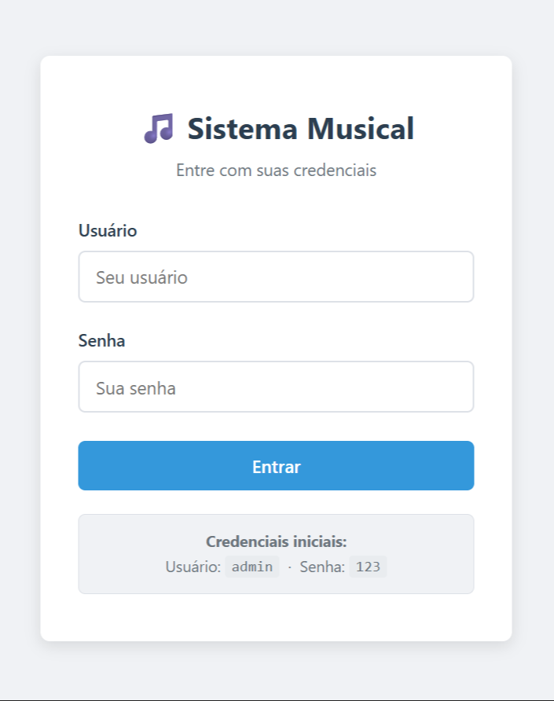
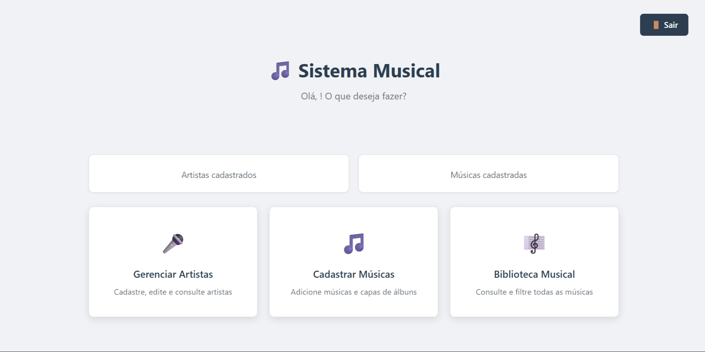
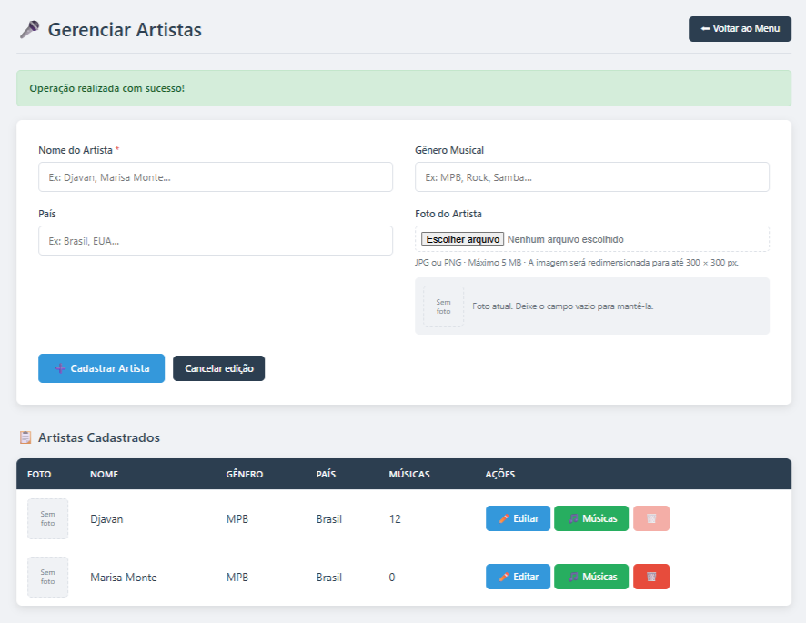
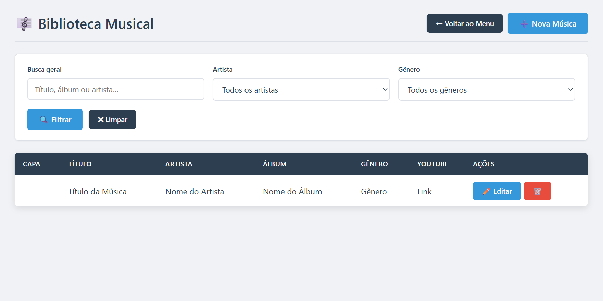
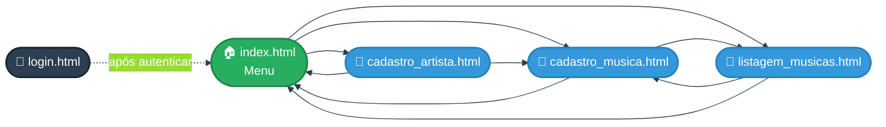

<div align="center">



<a href="https://git.io/typing-svg"></a>

<br>


<br>

[](#-as-5-telas)
[](#-mapa-de-navegação)
[](#-paleta-de-cores)
[](#-responsividade)
[](#%EF%B8%8F-como-abrir-o-projeto)
[](#-estrutura-do-repositório)
[](#-equipe)

</div>


## 🎶 Sobre o projeto

O **Sistema Musical** é o front-end de um **catálogo de músicas**: você cadastra **artistas**, cadastra as **músicas** de cada um e consulta tudo numa **biblioteca com filtros**.

Esta etapa entrega somente a **interface** (HTML + CSS): cinco telas ligadas por links, formulários com validação nativa do navegador e um layout que se ajusta sozinho ao computador e ao celular.

<div align="center">

| 🎯 Tema | 🎤 Criador | 🎵 Obra | 🏫 Disciplina |
|:---:|:---:|:---:|:---:|
| **Música** | **Artista** | **Música** | **Aulas 11, 12, 13 e 14** |

</div>


## ✨ Destaques

<table>
<tr>
<td align="center" width="33%">

### 🎨
**Um único `styles.css`**

Todas as telas compartilham a mesma folha de estilos, organizada em seções numeradas.

</td>
<td align="center" width="33%">

### 🧩
**Paleta no `:root`**

Cores, sombras, raio de borda e fonte viram variáveis CSS. Mudou uma, mudou o site todo.

</td>
<td align="center" width="33%">

### 📱
**Pensado para o celular**

Menu, formulários, filtros e tabelas se reorganizam em telas pequenas.

</td>
</tr>
<tr>
<td align="center">

### ✅
**Validação nativa**

`required`, `maxlength` e `accept` barram campos vazios e arquivos errados.

</td>
<td align="center">

### 🛡️
**Confirmação ao excluir**

Todo botão 🗑️ pergunta antes de enviar. Nada some por acidente.

</td>
<td align="center">

### 🧱
**Pronto para o back-end**

`method`, `action`, `enctype` e campos ocultos (`acao`, `id`) já estão no lugar.

</td>
</tr>
</table>


## 📺 As 5 telas

> 💡 Clique em **“Campos e regras”** para abrir os detalhes de cada tela.

<table>
<tr>
<td align="center" width="50%">

**1️⃣ Login** · `login.html`



</td>
<td align="center" width="50%">

**2️⃣ Menu principal** · `index.html`



</td>
</tr>
<tr>
<td align="center">

**3️⃣ Cadastro do criador** · `cadastro_artista.html`



</td>
<td align="center">

**4️⃣ Cadastro da obra** · `cadastro_musica.html`



</td>
</tr>
<tr>
<td align="center" colspan="2">

**5️⃣ Listagem** · `listagem_musicas.html`


</td>
</tr>
</table>

### 🔐 Tela 1 — Login

Cartão centralizado com **usuário** e **senha** (os dois obrigatórios) e uma dica com as credenciais iniciais.

<details>
<summary><b>📋 Campos e regras</b></summary>

<br>

| Campo | Tipo | Regra | Valor inicial |
|---|---|---|---|
| 👤 Usuário | texto | obrigatório | `admin` |
| 🔑 Senha | senha | obrigatório | `123` |

</details>

### 🏠 Tela 2 — Menu principal

Painel com **contadores** de artistas e músicas, três **cards de navegação** e o botão **🚪 Sair**.

<details>
<summary><b>📋 Cards e destinos</b></summary>

<br>

| Card | Descrição | Leva para |
|---|---|---|
| 🎤 Gerenciar Artistas | Cadastre, edite e consulte artistas | `cadastro_artista.html` |
| 🎵 Cadastrar Músicas | Adicione músicas e capas de álbuns | `cadastro_musica.html` |
| 🎼 Biblioteca Musical | Consulte e filtre todas as músicas | `listagem_musicas.html` |

</details>

### 🎤 Tela 3 — Cadastro do criador (artista)

Formulário em **duas colunas** e, logo abaixo, a tabela dos artistas cadastrados. O botão de excluir fica **desabilitado** enquanto o artista tiver músicas vinculadas.

<details>
<summary><b>📋 Campos e regras</b></summary>

<br>

| Campo | Tipo | Regra |
|---|---|---|
| Nome do Artista `*` | texto | obrigatório · até 100 caracteres |
| Gênero Musical | texto | até 50 caracteres |
| País | texto | até 50 caracteres |
| Foto do Artista | arquivo | JPG ou PNG · máx. 5 MB |

**Tabela:** foto, nome, gênero, país, nº de músicas e ações (✏️ Editar · 🎵 Músicas · 🗑️ Excluir).

</details>

### 🎵 Tela 4 — Cadastro da obra (música)

Formulário para registrar uma música e vinculá-la a um artista.

<details>
<summary><b>📋 Campos e regras</b></summary>

<br>

| Campo | Tipo | Regra |
|---|---|---|
| Título da Música `*` | texto | obrigatório · até 120 caracteres |
| Artista `*` | lista de seleção | obrigatório |
| Álbum | texto | até 100 caracteres |
| Gênero Musical | texto | até 50 caracteres |
| Link do YouTube | URL | precisa ser um endereço válido |
| Capa do Álbum | arquivo | JPG ou PNG · máx. 5 MB |
| Letra da Música | área de texto | opcional · ocupa as 2 colunas |

</details>

### 🎼 Tela 5 — Listagem (Biblioteca Musical)

Filtros no topo e tabela com todas as músicas.

<details>
<summary><b>📋 Filtros e colunas</b></summary>

<br>

- 🔍 **Busca geral** por título, álbum ou artista
- 🎤 Filtro por **artista** · 🎼 filtro por **gênero**
- 🧹 Botões **Filtrar** e **Limpar**
- ➕ Atalho **Nova Música** no topo

| Coluna | O que mostra |
|---|---|
| Capa | imagem do álbum |
| Título · Artista · Álbum · Gênero | dados da música |
| YouTube | link para assistir |
| Ações | ✏️ Editar · 🗑️ Excluir |

</details>


## 🧭 Mapa de navegação



<sub>Linha tracejada = ligação que depende do back-end (veja [Escopo desta entrega](#-escopo-desta-entrega)).</sub>


## 🎨 Paleta de cores

Todas as cores moram no `:root` do `styles.css`. Mudou a variável, mudou o site inteiro. 🪄



```css
:root {
    --primary:     #2c3e50;   /* títulos, cabeçalho da tabela, botão Voltar */
    --blue:        #3498db;   /* botão principal, editar, foco dos campos   */
    --blue-dark:   #2980b9;   /* hover dos botões azuis                     */
    --green:       #27ae60;   /* botão Músicas, mensagem de sucesso         */
    --red:         #e74c3c;   /* botão excluir, asterisco de obrigatório    */
    --red-dark:    #c0392b;   /* hover do botão excluir                     */
    --bg:          #f0f2f5;   /* fundo das páginas                          */
    --surface:     #ffffff;   /* cards, formulários e tabelas               */
    --border:      #dde1e7;   /* bordas e divisórias                        */
    --text-muted:  #6c757d;   /* textos de apoio                            */
    --radius:      8px;       /* cantos arredondados                        */
    --font:        'Segoe UI', system-ui, -apple-system, sans-serif;
}
```


## 📱 Responsividade

<table>
<tr>
<th align="center">🖥️ Acima de 768px</th>
<th align="center">📱 Até 768px</th>
<th align="center">📱 Até 600px</th>
</tr>
<tr>
<td valign="top">

- Formulários em **2 colunas**
- Filtros **lado a lado**
- Menu com cards em **grade**

</td>
<td valign="top">

- Formulários em **1 coluna**
- Filtros **empilhados**
- Menu em **coluna única**
- Botões de ação menores
- Tabelas com **rolagem horizontal**

</td>
<td valign="top">

- Contadores do menu em **2 colunas**
- Filtro de artista em **largura total**

</td>
</tr>
</table>

> 🔎 **Testar o modo celular:** abra a página, aperte `F12`, clique no ícone de dispositivos (ou `Ctrl + Shift + M`) e escolha um celular.


## 🛠️ Tecnologias

<div align="center">


</div>

Sem frameworks e sem bibliotecas. Nesta fase, a única interação extra é o `confirm()` nativo do botão excluir.


## ▶️ Como abrir o projeto

<details open>
<summary><b>⚡ Opção 1 — Direto no navegador (mais simples)</b></summary>

<br>

1. Baixe ou clone o repositório
2. Dê dois cliques em **`login.html`**
3. Navegue pelas telas usando os links e botões

</details>

<details>
<summary><b>💻 Opção 2 — Clonando com Git</b></summary>

<br>

```bash
git clone https://github.com/SEU-USUARIO/musica-vinycius.git
cd musica-vinycius
```

Depois é só abrir o `login.html` no navegador.

</details>

<details>
<summary><b>🌐 Opção 3 — Online com GitHub Pages</b></summary>

<br>

1. No repositório, vá em **Settings → Pages**
2. Em *Branch*, escolha `main` e a pasta `/ (root)`
3. Salve e aguarde o link de publicação aparecer

</details>

> ⚠️ Como ainda não há back-end, o botão **Entrar** não redireciona sozinho. Para continuar, abra o `index.html`.


## 📁 Estrutura do repositório

```text
📦 musica-vinycius
 ┣ 📄 login.html              → Tela 1 · login
 ┣ 📄 index.html              → Tela 2 · menu principal
 ┣ 📄 cadastro_artista.html   → Tela 3 · cadastro do criador (artista)
 ┣ 📄 cadastro_musica.html    → Tela 4 · cadastro da obra (música)
 ┣ 📄 listagem_musicas.html   → Tela 5 · biblioteca com filtros
 ┣ 🎨 styles.css              → único arquivo de estilos (paleta no :root)
 ┣ 📂 prints/                 → capturas de tela das páginas
 ┣ 📂 assets/                 → banner, divisor e paleta animados do README
 ┗ 📘 README.md               → você está aqui
```

<details>
<summary><b>🧱 Como o <code>styles.css</code> está organizado</b></summary>

<br>

| Seção | Conteúdo |
|:---:|---|
| 1 | Variáveis (`:root`) e *reset* |
| 2 | Formulários (campos, rótulos, foco) |
| 3 | Botões (primário, voltar, editar, excluir, músicas, YouTube) |
| 4 | Mensagens de sucesso e erro |
| 5 | Tela de login |
| 6 | Layout base (`.container`) |
| 7 | Menu principal |
| 8 | Tipografia (`h2`, `h3`) |
| 9 | Cabeçalho de página com ações |
| 10 | Formulário em grade de 2 colunas |
| 11 | Tabelas |
| 14 | Filtros |
| 15 | Utilitários (`.mt-1`, `.mb-2`, `.text-center`…) |
| 16 | Responsividade (`@media`) |
| 17 | Elementos adicionais (contadores, botões desabilitados, formulários em linha) |

</details>


## ✅ Checklist da atividade

| | Requisito |
|:---:|---|
| ✅ | 🖥️ As 5 telas: login, menu, cadastro do criador, cadastro da obra e listagem |
| ✅ | 🎨 Um único `styles.css` com a paleta no `:root` |
| ✅ | 📱 Funcionando no computador e no celular |
| ✅ | 👥 Nome dos integrantes em comentário no topo do `login.html` |
| ✅ | 📤 Arquivos soltos na raiz do repositório (sem `.zip`) |
| ✅ | 🔓 Repositório público |

<details>
<summary><b>🔎 Roteiro de testes</b></summary>

<br>

1. Abrir o `login.html`
2. Navegar por todas as telas pelos links
3. Tentar cadastrar com **campo vazio**. O navegador deve bloquear e avisar o campo obrigatório
4. Abrir no **modo celular** (`F12`) e conferir se nada quebra

</details>


## 🧭 Escopo desta entrega

Esta é a **fase de front-end**. Por isso:

- 📝 Os dados das tabelas (Djavan, Marisa Monte, “Título da Música”…) são **exemplos fixos**, só para mostrar o visual
- 🔗 Os formulários estão **preparados** para um back-end, mas ainda não salvam nada
- 🚪 O botão **Sair** aponta para `logout.php`, que será criado na fase de back-end
- 🔐 A autenticação do login vem na próxima etapa

### 🚀 Próximos passos

- [ ] Back-end para salvar artistas e músicas
- [ ] Autenticação real no login
- [ ] Upload e redimensionamento das imagens
- [ ] Filtros funcionando de verdade na biblioteca
- [ ] Contadores do menu alimentados pelo banco de dados


## 👥 Equipe

<div align="center">

| 👤 Integrante | 🎯 Função |
|:---:|:---:|
| **Vinycius Lopes Monteiro da Silva** | 💻 Desenvolvimento |

<sub>Os nomes também estão no comentário no topo do `login.html`.</sub>

<br>

### ⭐ Gostou do projeto? Deixe uma estrela no repositório!


</div>
